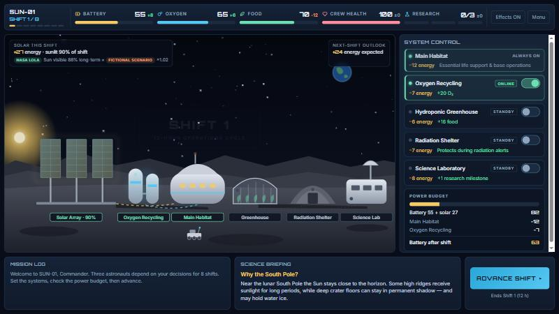
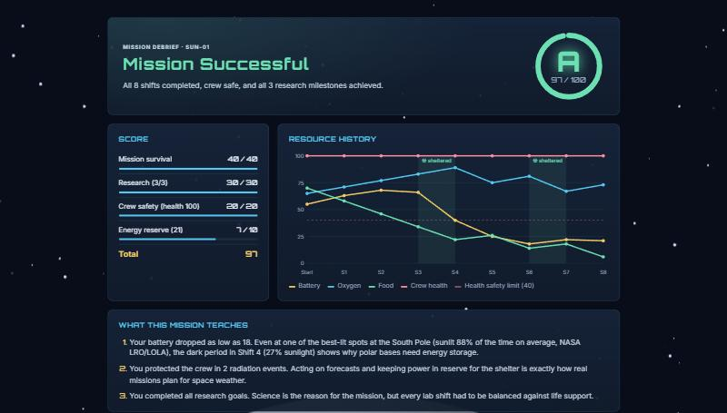

# SUN: Lunar Outpost

**NASA Space Apps Challenge 2026 · "Build a Junior Astronaut Mission Trainer" · Team SUN**

An educational 2D strategy game for students aged 12–18 (8–12 minutes per mission). You command SUN-01, a three-person research base near the Moon's South Pole. Over twelve 12-hour shifts in three chapters you balance power, oxygen, food, radiation safety and science, build upgrades, and respond to five forecast emergencies — every decision is a trade-off. Korean and English.



## Play
- **Source:** https://github.com/gonutyun-sketch/sun-lunar-outpost
- **Live demo:** _GitHub Pages URL (https://gonutyun-sketch.github.io/sun-lunar-outpost/) once Pages is enabled with source "GitHub Actions"_
- Locally: `npm install` then `npm run dev`, and open http://localhost:5173

## How to play
1. Each shift, switch facilities on or off: Oxygen Recycling, Hydroponic Greenhouse, Radiation Shelter, Science Lab. The Main Habitat is always on.
2. Check the power budget. Solar panels charge the battery first, and then every running system draws from it.
3. Build upgrades (Solar, Oxygen Recycler, Battery): pay energy now, gain from the next shift.
4. Emergencies are forecast one shift ahead; when one arrives, choose one of two responses.
5. Press **ADVANCE SHIFT** and read the shift report.
6. Launch the rover for hands-on repair and science missions (keyboard WASD/arrows + E, or the on-screen joystick and action button on phones and tablets).

Progress is saved automatically in your browser (no account, no personal data): use **CONTINUE** on the main menu to resume.

**Full success:** survive 12 shifts, keep crew health ≥ 40, keep oxygen and food above 0, and complete 4 research milestones. **Score:** survival 40 + research 30 + crew safety 20 + energy reserve 10.

## NASA data
The base sits at **89.4749°S, 137.4431°W**, a ridge near Shackleton crater. Its solar power uses the **NASA LRO/LOLA average solar illumination** product `AVGVISIB_85S_060M_201608` ([PGDA product 69](https://pgda.gsfc.nasa.gov/products/69)):

| Location (same NASA map) | Average time sunlit |
|---|---|
| SUN-01 site pixel (60 m) | **88.44%** |
| 300 m × 300 m area around it | 55.36% |
| Shackleton crater floor | 0% (permanent shadow) |

- **What 88.44% means:** the long-term (18.6-year) share of time that any part of the Sun's disc is visible from the site. It is **not** solar-panel efficiency, and it is **not** a forecast.
- **In the game:** `sunlight = min(1, 0.88444 × fictional scenario modifier)` and `solar = round(30 × sunlight)`. The per-shift modifiers, radiation events, costs and resource units are fictional training values.
- **Extraction:** `node tools/extract-illumination.mjs` reads only the needed rows of the NASA file using HTTP Range requests. Map orientation was verified against known permanently shadowed craters.
- **Citation:** Mazarico, E., et al. (2011), *Illumination conditions of the lunar polar regions using LOLA topography*, Icarus 211, 1066–1081, doi:10.1016/j.icarus.2010.10.030. Visual reference: NASA SVS 4930.

## Tech
React 18 + TypeScript + Vite, plus Vitest. The game is a static site with no backend, accounts, or runtime AI. All simulation rules are pure functions in `src/game/engine.ts` and are covered by unit tests (79 in total, incl. save/continue and rover physics) plus balance bots; an exact best-play search (`npm run analyze`) confirms a perfect 100 is possible.

```bash
npm run typecheck
npm test
npm run build   # -> dist/
```

## AI disclosure
Built with help from Claude Code (Anthropic). See [AI_USAGE.md](AI_USAGE.md).

## Screenshots
| Radiation alert | Results |
|---|---|
|  |  |
